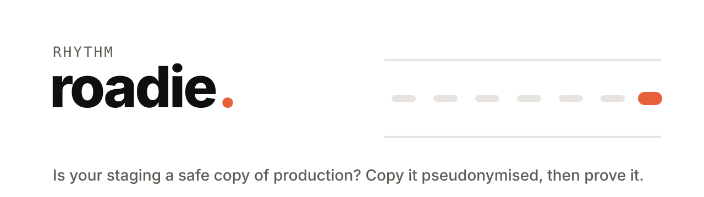
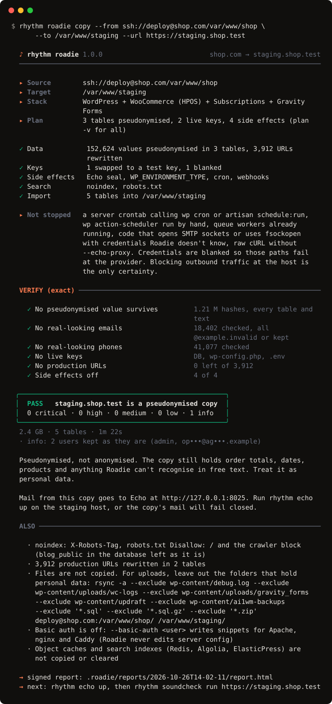

<p align="center">
  <picture>
    <source media="(prefers-color-scheme: dark)" srcset="docs/assets/banner-dark.svg">
    
  </picture>
</p>

<p align="center">
  <b>Is my staging a safe copy of production?</b><br>
  Generic anonymisers don't know WordPress. WordPress staging tools don't remove your customers. Roadie does both and proves it: it copies production to staging with every customer pseudonymised, live payment and mail keys swapped for test keys and cron, webhooks and mail turned off, then checks the finished copy and signs a pass or fail report.
</p>

<p align="center">
  <a href="https://github.com/RhythmShahriar/roadie/releases/latest"></a>
  <a href="https://github.com/RhythmShahriar/roadie/actions/workflows/ci.yml"></a>
  <a href="LICENSE"></a>
</p>

<p align="center">
  <a href="#try-it-in-a-minute">Try it</a> ·
  <a href="#copy-a-site">Copy a site</a> ·
  <a href="#make-an-existing-staging-safe">Prepare</a> ·
  <a href="#check-a-staging">Verify</a> ·
  <a href="#github-action">GitHub Action</a> ·
  <a href="https://github.com/RhythmShahriar/rhythm/wiki/Roadie">Docs</a>
</p>

<br>

<p align="center">
  
</p>

<br>

## The Rhythm set

| | Asks | Checks |
|---|---|---|
| [rhythm](https://github.com/RhythmShahriar/rhythm) | Which tools do I have? | installs, updates and runs the set as `rhythm <tool>` |
| [Tuner](https://github.com/RhythmShahriar/tuner) | Is my site safe? | what an attacker can find |
| [Soundcheck](https://github.com/RhythmShahriar/soundcheck) | Did my change break anything? | what visitors see and do |
| [Echo](https://github.com/RhythmShahriar/echo) | Is my site still saying what it should? | everything the site sends |
| **Roadie** | **Is my staging a safe copy of production?** | **real people, live keys and side effects in the copy** |

## Try it in a minute

```sh
rhythm install roadie
rhythm roadie demo
```

`demo` builds a small WooCommerce shop with fake customers, a live-looking Stripe key, an active webhook and production URLs in serialized and JSON-escaped forms. It plans and copies it, verifies the copy (PASS), then verifies the untouched input (FAIL) and deletes everything again. No network, no database server, a few seconds.

New to rhythm? Install it first:

```sh
curl -fsSL https://rythm.sh/install | sh               # macOS · Linux
irm https://rythm.sh/install.ps1 | iex                 # Windows (PowerShell)
go install github.com/RhythmShahriar/roadie/cmd/rhythm-roadie@latest
```

`rhythm roadie` and `rhythm-roadie` are the same command: the `rhythm` CLI runs the `rhythm-roadie` binary for you.

## Safety promises

- **Production is read-only.** Roadie opens the source read-only and over SSH runs only a fixed list of read commands ([the list](https://github.com/RhythmShahriar/rhythm/wiki/Roadie-Sources-And-Targets)).
- **Production is never a target.** A target that matches `production:`, is the same database as the source or says it is production is refused before anything is written.
- **No real data on your disk.** `copy` streams from source to target; a dump you pass is never rewritten in place and a stream read twice is spooled encrypted with a key held only in memory.
- **Every copy is verified.** `copy` and `prepare` end with a verify that reads the finished copy, never what Roadie believed it changed.
- **Pseudonymised, not anonymised.** The copy still holds order totals, dates, products and anything Roadie can't recognise in free text. Treat it as personal data.
- **No network beyond what you name.** The source and target you give, the staging URL for `verify --site`, Echo at the address you set and the update check. Nothing else.

## Copy a site

Look first: `plan` prints every table, column, rule, key, file edit, remote command and side effect. It changes nothing.

```sh
rhythm roadie config init --stack woocommerce     # .roadie/config.yaml to edit and commit
rhythm roadie plan --from shop.sql --to staging.sql
rhythm roadie copy --from shop.sql --to staging.sql --url https://staging.shop.test
```

Straight from production over SSH to a staging site, with nothing written to your disk:

```sh
rhythm roadie copy --from ssh://deploy@shop.com/var/www/shop \
  --to /var/www/staging --url https://staging.shop.test
```

Sources and targets are dump files (`.sql`, `.sql.gz`, `.sql.zst`), `-`, site folders, `ssh://user@host/path`, WP-CLI `@aliases` and database DSNs (`mysql://`, `postgres://`, `sqlite://`). Passwords come from `ROADIE_FROM_PASSWORD` and `ROADIE_TO_PASSWORD`, never the command line. SSH runs your own `ssh` with your `known_hosts`; Roadie never turns host key checking off.

## Make an existing staging safe

A staging made by WP STAGING, WP Migrate or a host panel still holds your customers and live keys. `prepare` fixes it in place, after a backup:

```sh
rhythm roadie plan /var/www/staging
rhythm roadie prepare /var/www/staging
rhythm roadie prepare /var/www/staging --only side-effects    # after a plugin update
```

It asks you to type the site's host first. In CI pass `--confirm-target <host>`.

## Check a staging

`verify` looks for real-looking emails, phones, names, addresses, IPs and cards, live keys, production URLs and side effects that are still on. It exits 1 when it finds something at or above `--fail-on` (default high).

```sh
rhythm roadie verify /var/www/staging --production shop.com
rhythm roadie verify staging.sql --from shop.sql         # exact: every real value, in every encoding
rhythm roadie report check .roadie/reports/<run>/report.json
```

Each run writes a signed `report.json` and `report.html` under `.roadie/reports/`; `--md`, `--html`, `--sarif` and `--junit` render the same report for pull requests and CI. The signature shows who ran Roadie, which version and rules, on which input and that the report is unchanged since. It doesn't prove the data holds no personal data.

Exit codes are the set's: 0 ok, 1 findings at or above `--fail-on`, 2 usage error, 3 couldn't run, 130 interrupted.

## What Roadie changes

| Stack | Pseudonymised | Keys | Side effects off |
|---|---|---|---|
| **WordPress** (single and multisite) | users, user meta, comments, order notes, admin emails; sessions and application passwords removed; passwords made unusable | payment, mail, SMS and cloud keys in options, `wp-config.php` and `.env`; salts regenerated | `WP_ENVIRONMENT_TYPE=staging`, Echo's mail seal, WP-Cron, Action Scheduler, webhooks paused, gateways in test mode, Subscriptions staging mode, Jetpack offline, noindex |
| **WooCommerce** (legacy and HPOS) | orders, addresses, customer lookup, download logs; sessions and payment tokens cleared | Stripe, PayPal, WooPayments, Square, Braintree, Mollie and more: live swapped for your test keys or blanked | as WordPress |
| **Forms, mail logs, shops** | Gravity Forms, WPForms, Contact Form 7 + Flamingo, Ninja Forms, Fluent Forms, MailPoet, EDD, MemberPress, LearnDash; mail log bodies cleared | as WordPress | AutomateWoo queue cleared |
| **Laravel** (with Cashier) | `users` and the tables you list; sessions, tokens, jobs and caches cleared | `.env` keys; `APP_KEY` rotated | mail to Echo's SMTP sink, queue in sync mode |
| **Any SQL** (MySQL, MariaDB, PostgreSQL, SQLite) | the columns you name, plus a scan that stops on any column that looks personal and has no rule | live-looking keys in the data | none: a database alone has no config to change |

Fake values are consistent across tables and keep their shape (a fake email at `example.invalid`, a fiction-range phone, a reserved IP). PHP serialized data and JSON-escaped URLs stay valid. Every rule is in [Roadie-Profiles](https://github.com/RhythmShahriar/rhythm/wiki/Roadie-Profiles) and [Roadie-Kill-Switch](https://github.com/RhythmShahriar/rhythm/wiki/Roadie-Kill-Switch).

## What Roadie can't see

Not covered by any report: files and uploads (PDF invoices, form uploads, images with location data), other databases, object caches (Redis, Memcached), search indexes (Algolia, ElasticPress), logs on disk outside wp-content, copies held by third parties (Mailchimp lists, Stripe customers), names and street addresses written in free text that Roadie didn't see in a structured column, encrypted columns, tables you told Roadie to keep.

The kill switch can't stop a server crontab calling `wp cron` or `artisan schedule:run`, `wp action-scheduler run` by hand, queue workers already running, code that opens SMTP sockets or uses `fsockopen` with credentials Roadie doesn't know, or raw cURL without `--echo-proxy`. Credentials are blanked so those paths fail at the provider. Blocking outbound traffic at the host is the only certainty.

Theme and plugin code is scanned for live keys on local site targets only; over SSH Roadie reads only `wp-config.php` and `.env`. For file-level leaks run `rhythm tuner scan <staging dir>`.

## GitHub Action

Refresh staging from production every night, then check it with Soundcheck:

```yaml
on:
  schedule: [{cron: "0 3 * * *"}]
jobs:
  staging:
    runs-on: ubuntu-latest
    steps:
      - uses: actions/checkout@v5
      - uses: RhythmShahriar/roadie@v1
        with:
          mode: copy
          source: ssh://deploy@shop.com/var/www/shop
          target: ssh://deploy@staging.shop.com/var/www/staging
          url: https://staging.shop.com
          confirm-target: staging.shop.com
          ssh-key: ${{ secrets.DEPLOY_KEY }}
          known-hosts: ${{ secrets.KNOWN_HOSTS }}
          args: --yes
        env:
          ROADIE_SIGNING_KEY: ${{ secrets.ROADIE_SIGNING_KEY }}
          ROADIE_STRIPE_TEST_SECRET: ${{ secrets.STRIPE_TEST_SECRET }}
      - uses: RhythmShahriar/soundcheck@v1
        with: {url: https://staging.shop.com, mode: run}
```

`mode` is `verify` (the default), `copy`, `prepare` or `plan`. The job summary holds counts only unless `summary-details: "true"`; reports are uploaded only with `upload: "true"`. `copy` and `prepare` are refused in a pull request from a fork. Every input and output is in [Roadie-CI](https://github.com/RhythmShahriar/rhythm/wiki/Roadie-CI) and [action.yml](action.yml).

## Verify a download

Releases are signed keylessly with cosign by the shared release workflow. Check `checksums.txt`, then the archive (here v1.0.0 on Linux):

```sh
cosign verify-blob \
  --bundle checksums.txt.sigstore.json \
  --certificate-identity-regexp '^https://github\.com/RhythmShahriar/\.github/\.github/workflows/release-go\.yml@' \
  --certificate-oidc-issuer https://token.actions.githubusercontent.com \
  --certificate-github-workflow-repository RhythmShahriar/roadie \
  --certificate-github-workflow-ref refs/tags/v1.0.0 \
  checksums.txt
sha256sum --ignore-missing -c checksums.txt
```

The installers and the GitHub Action run the same check before anything from a download runs.

## Docs

| | |
|---|---|
| [Getting started](https://github.com/RhythmShahriar/rhythm/wiki/Roadie-Getting-Started) | the demo, a first plan and copy, Echo on the staging host, logging in |
| [CLI reference](https://github.com/RhythmShahriar/rhythm/wiki/Roadie-CLI-Reference) | every command, flag, exit code and the JSON schema |
| [Configuration](https://github.com/RhythmShahriar/rhythm/wiki/Roadie-Configuration) | `.roadie/config.yaml` |
| [Sources and targets](https://github.com/RhythmShahriar/rhythm/wiki/Roadie-Sources-And-Targets) | dumps, sites, SSH, aliases, DSNs and the remote command list |
| [Profiles](https://github.com/RhythmShahriar/rhythm/wiki/Roadie-Profiles) | each stack's tables, columns and rules |
| [Pseudonymisation](https://github.com/RhythmShahriar/rhythm/wiki/Roadie-Pseudonymisation) | fake formats, keys, consistency, passwords |
| [Live keys](https://github.com/RhythmShahriar/rhythm/wiki/Roadie-Live-Keys) | what is found and how it is swapped |
| [Kill switch](https://github.com/RhythmShahriar/rhythm/wiki/Roadie-Kill-Switch) | each switch, how to undo it for a test, its limits |
| [Verify and reports](https://github.com/RhythmShahriar/rhythm/wiki/Roadie-Verify-And-Reports) | detectors, modes, signatures, `report check` |
| [CI](https://github.com/RhythmShahriar/rhythm/wiki/Roadie-CI) | the Action, a nightly refresh, secrets |
| [Laravel](https://github.com/RhythmShahriar/rhythm/wiki/Roadie-Laravel) · [Generic SQL and Postgres](https://github.com/RhythmShahriar/rhythm/wiki/Roadie-Generic-SQL-And-Postgres) · [Multisite](https://github.com/RhythmShahriar/rhythm/wiki/Roadie-Multisite) | stack guides |
| [Security and limits](https://github.com/RhythmShahriar/rhythm/wiki/Roadie-Security-And-Limits) | what Roadie promises, every network request it can make |
| [Troubleshooting](https://github.com/RhythmShahriar/rhythm/wiki/Roadie-Troubleshooting) · [FAQ](https://github.com/RhythmShahriar/rhythm/wiki/Roadie-FAQ) | every error code; common questions |

All of it lives in the **[Rhythm documentation wiki](https://github.com/RhythmShahriar/rhythm/wiki/Roadie)**. What comes after 1.0 is in the [roadmap](ROADMAP.md).

## Contributing

```sh
git clone https://github.com/RhythmShahriar/roadie && cd roadie
make hooks   # Conventional Commits check
make check   # lint + tests
```

How a profile and a detector plug in, the fixture rule and fake keys built at runtime: [CONTRIBUTING](CONTRIBUTING.md).

## Responsible use & disclaimer

- **Use it only on sites you own or are authorised to copy.** Roadie reads production data to pseudonymise it.
- **Pseudonymised data is still personal data** under the GDPR (Article 4(5), Recital 26). Keep copies and reports as protected as the live site; reports hold metadata about production.
- **Never push a staging database back to production.** Its customers are fake.
- **No warranty.** Roadie is provided "as is", as set out in the [license](LICENSE). A report shows what Roadie's checks found, not that a copy holds no personal data.

Found a vulnerability in Roadie itself? Please [report it privately](https://github.com/RhythmShahriar/roadie/security/advisories/new).

## License

[MIT](LICENSE).

<p align="center"><sub>Part of <a href="https://github.com/RhythmShahriar/rhythm"><b>rhythm</b></a> · Useful ideas. Working systems.</sub></p>
